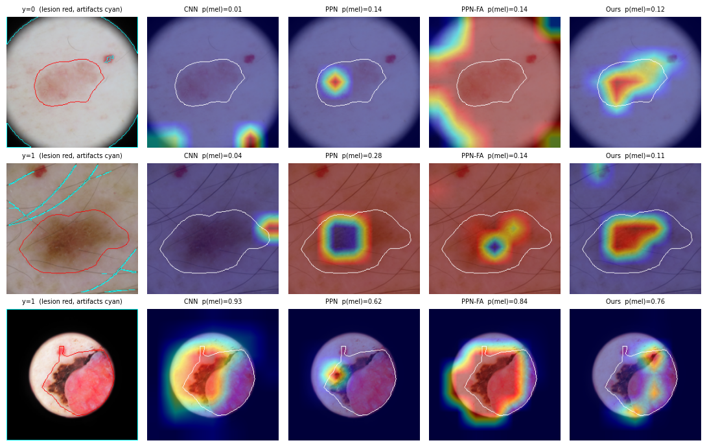
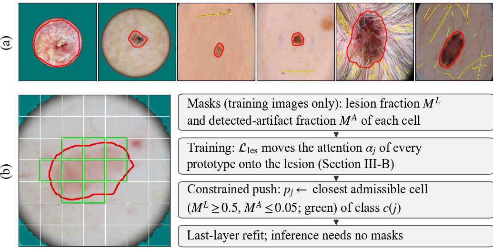
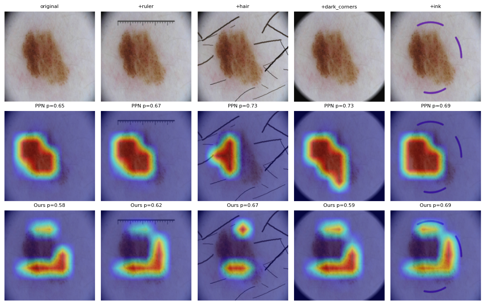

# Lesion-Anchored Prototypes

**Reducing Artifact Shortcuts in Interpretable Melanoma Classification**

Yousef Azizi Movahed, Fatemeh Ziaeetabar
Department of Computer Science, School of Mathematics, Statistics, and Computer Science, College of Science, University of Tehran

This repository contains the complete code, the executed notebooks and the logs behind the paper (CSICC 2026 submission). All results in the paper can be traced to the files in `results/` (see [Traceability](#traceability)).

<p align="center">
  <br>
  <em>ISIC 2019 test images with artifacts. The black-box CNN and a mask-supervised ProtoPNet (PPN-FA, IAIA-BL loss on 7×7 maps) respond to dark corners and image borders; the most active prototype of our model stays on the lesion.</em>
</p>

## Summary

Melanoma classifiers trained on dermoscopic archives pick up acquisition artifacts such as dark vignetting corners, rulers and ink. In a prototypical part network (ProtoPNet) the explanation itself can then point at the artifact. We

1. **audit the bias** on ISIC 2019 with automatically detected artifact masks, a leakage-free split and source-stratified statistics (dark corners: Mantel–Haenszel OR 1.555 [1.43, 1.69]; bright structures: 1.751 [1.59, 1.92]);
2. **anchor prototypes to the lesion** with two components: a lesion-attraction loss on the normalized spatial attention of each prototype and a projection ("push") restricted to cells that are at least half lesion and contain at most 5% detected artifact, so every prototype comes from a lesion-dominated patch. Lesion attraction drives accuracy and robustness; the projection fixes this provenance without changing accuracy or decisions. No new annotation is needed: lesion masks are the public HAM10000 segmentations or are predicted by a segmentation network trained on them, and artifact masks come from fixed image operations (validated against public manual artifact labels: precise, but they miss many faint artifacts). The main model also contains an auxiliary artifact-suppression term, which had only small, mixed effects; it is reported as a largely negative result and not claimed as a contribution;
3. **test decisions and explanations with counterfactuals**: rulers, hair, dark corners and ink are inserted (and real hair/ruler marks removed) while every lesion pixel stays bit-identical, with an inpainting-only null control, complemented by a shortcut test on unedited images, lesion-only and background-only test images and a detector-free audit of every prototype;
4. **audit the masks, the split and the statistics**: the conclusions are re-checked on test images with expert masks only, under ±5 px mask erosion/dilation and per acquisition source; a leakage audit confirms that no group, lesion or near-duplicate pair is shared between train, validation and test; all test statistics resample lesion groups, and the main claims form a Holm-corrected primary family.

<p align="center">
  <br>
  <em>(a) Automatic lesion (red) and artifact masks (cyan: dark corners; yellow: rulers and hair). (b) Method overview: the 7×7 cells that the constrained projection admits (green) and the pipeline.</em>
</p>

All eight configurations, four further variants of the mask-loss baseline (other weights and the original IAIA-BL / Correia et al. formulations) and the combination of our model with the Correia et al. loss use the same DenseNet-121 backbone, data split and training budget and are trained with three seeds; ProtoPNet, the Correia et al. formulation and Ours have four further seeds each (notebooks 09 and 10).

## Main results

ISIC 2019 test set (n = 2,320 images in 1,234 lesion groups), mean ± std over three seeds; external AUC on unseen datasets.

| Model | AUC | BAcc | Seed-ensemble AUC [95% CI] | Derm7pt-derm | Derm7pt-clin | PAD-UFES-20 |
|---|---|---|---|---|---|---|
| CNN (black box) | .902 ± .006 | .814 ± .011 | .912 [.884, .935] | .799 ± .023 | .704 ± .022 | .721 ± .022 |
| ProtoPNet, std. aug. | .835 ± .013 | .752 ± .014 | .861 [.827, .888] | .677 ± .027 | .624 ± .023 | .587 ± .019 |
| ProtoPNet | .825 ± .040 | .758 ± .010 | .866 [.830, .894] | .688 ± .072 | .618 ± .038 | .665 ± .016 |
| ProtoPNet + IAIA-BL loss (PPN-FA, 7×7 maps, batch mean) | .844 ± .008 | .744 ± .021 | .866 [.830, .895] | .696 ± .024 | .640 ± .013 | .630 ± .059 |
| **Ours** (main model: two core components + auxiliary artifact-suppression term) | **.865 ± .006** | **.780 ± .014** | **.884 [.850, .910]** | **.749 ± .009** | **.657 ± .019** | .647 ± .108 |
| Ours, two core components only (Ours-noArt) | .859 ± .011 | .772 ± .003 | .877 [.845, .904] | .752 ± .014 | .637 ± .030 | .678 ± .018 |

Where the models look and how they react to inserted artifacts (ISIC test):

| Model | Hot region on artifacts ↓ | Artifact enrichment ↓ | Prototypes on lesion cells, ≥50% lesion (of 20) | Flip rate, +dark corners ↓ | Flip rate, +ruler ↓ | Map stability ρ, +dark corners ↑ |
|---|---|---|---|---|---|---|
| CNN | 23.1% | 1.52 | – | 6.1% | 5.6% | – |
| ProtoPNet | 6.6% | 0.46 | 14.3 | 10.9% | 7.5% | 0.68 |
| ProtoPNet + IAIA-BL | 10.2% | 0.68 | 10.0 | 10.6% | 6.5% | 0.71 |
| **Ours** | **4.8%** | **0.37** | **20.0** | **5.2%** | **3.6%** | **0.92** |

With a paired bootstrap over lesion groups, the ensemble AUC of Ours exceeds those of the three ProtoPNet baselines by 0.017–0.022 (Holm-adjusted p = 0.012, 0.042 and 0.029 in a primary family of 16 tests that also contains the comparison with the original Correia et al. mask-loss formulation), and all attribution and flip-rate differences are significant (Wilcoxon on lesion-group means, p ≤ 5.6e-4 and p ≤ 4.9e-8). The three Ours seeds of the main comparison are each more accurate than every seed of these baselines, including the four further ProtoPNet seeds of notebook 10 (13 seeds; ISIC test and Derm7pt-dermoscopic; a descriptive check); with the four further Ours networks of notebook 09 (seven seeds: AUC 0.863 ± 0.012, range 0.842–0.880), one seed falls below the best baseline seed. Every Ours seed flips fewer decisions under inserted dark corners and ink than 12 of the 13 baseline seeds (3.3–7.5% vs. 7.6–15.4%; ink: at most 184 vs. at least 185 of 2,301 images); the exception is the ProtoPNet seed with the lowest AUC of all runs (0.752; 2.0% and 6.4%). Across training runs (exact Mann–Whitney, `results/statistics/seven_run_tests.py`), the seven Ours seeds have a higher AUC than the 13 baseline seeds (p = 0.001) and flip fewer decisions under all four insertions (p ≤ 0.004); against the seven ProtoPNet seeds p = 0.007 (AUC) and p ≤ 0.026 (flips), against the seven seeds of the Correia et al. formulation p ≥ 0.62 (no difference). Every Ours seed keeps a more stable explanation than every seed of PPN-std and PPN-FA (ρ 0.85–0.93 vs. ≤ 0.77); ρ overlaps with two ProtoPNet seeds and with the mask-loss variants, the artifact share lies below every CNN seed but overlaps with the prototype baselines, and the captured share overlaps for all models. The two core components alone (Ours-noArt) keep all attribution and robustness advantages (p ≤ 5.2e-4), but their AUC gain over the three baselines (0.010–0.016) is not significant with lesion groups resampled (p = 0.07–0.17); the difference between Ours and Ours-noArt is not significant either (0.007, 95% CI [−0.004, 0.018]). At 90% sensitivity (test ROC), Ours has the highest specificity of the prototype models (64.8%; ProtoPNet baselines 58.9–60.2%, Correia et al. formulation 63.3%, CNN 69.6%; seed ensembles not significantly different, p ≥ 0.14; over seven runs against ProtoPNet p = 0.025), and a threshold set on validation data for 90% sensitivity reaches 92.6% sensitivity on test. The test-sample tests treat the trained models as fixed; variation over training runs is shown by the std over three seeds and tested over seven runs per model. Apart from the Holm-corrected primary family, all tests are secondary and exploratory. The main claims concern prototype provenance and robustness to artifacts, not accuracy: the AUC of Ours does not differ significantly from the strongest mask-supervised ProtoPNet and stays below the black-box CNN, and across training runs that mask loss is as robust as Ours. The loss weights and the eight configurations, including the choice of the main model, were fixed before any test evaluation; the projection thresholds (0.5 lesion, 0.05 artifact) were varied in notebook 09, projecting from the trained prototypes (see below).

**Mask-loss baseline, weight and formulation** (ISIC test; `notebooks/06_mask_loss_baseline.ipynb`). Our PPN-FA applies the IAIA-BL loss to the 7×7 maps and averages it over the batch, which makes λ = 1e-3 about three orders of magnitude weaker than in the original pixel-level, batch-summed formulations (factor 32 from the 224×224 norm, 64 from the batch sum). We therefore also trained those and two larger weights:

| Mask loss | AUC | Derm7pt-derm | Prototypes on lesion cells (≥50% lesion) | Hot region on artifacts | Flip, +dark corners | ρ, +dark corners | Real dark corners A |
|---|---|---|---|---|---|---|---|
| none (ProtoPNet) | .825 ± .040 | .688 | 14.3 | 6.6% | 10.9% | 0.68 | 0.61 |
| PPN-FA, λ = 1e-3 | .844 ± .008 | .696 | 10.0 | 10.2% | 10.6% | 0.71 | 0.66 |
| PPN-FA, λ = 1e-2 | .833 ± .018 | .695 | 16.0 | 12.1% | 12.2% | 0.80 | 0.66 |
| PPN-FA, λ = 1e-1 | .849 ± .006 | .711 | 9.3 | 6.1% | 7.2% | 0.84 | 0.60 |
| Correia et al. formulation | .867 ± .011 | **.771** | 13.0 | 14.1% | 6.5% | 0.87 | 0.57 |
| IAIA-BL formulation | .845 ± .011 | .715 | 18.0 | **3.9%** | 6.2% | 0.88 | 0.58 |
| **Ours** | .865 ± .006 | .749 | **20.0** | 4.8% | 5.2% | **0.92** | 0.57 |
| Ours + Correia et al. loss (notebook 08) | **.871 ± .004** | .736 | **20.0** | 4.3% | **5.0%** | 0.87 | **0.53** |

The ISIC AUC of the original (Correia) formulation does not differ significantly from that of Ours (ensemble difference −0.001, 95% CI [−0.012, 0.011]; this is not a formal equivalence test), and it generalizes better to the external sets, but only one of 19 mask-loss runs puts all prototypes on lesion-dominated cells, and on seeds 0–2 every variant flips significantly more decisions than Ours under inserted dark corners and ink. In the Holm-corrected primary family, Ours is significantly better than the Correia formulation on artifact share and dark-corner flips (p < 1e-6, p = 0.029), not on AUC or ruler flips. **These two advantages do not replicate on four further seeds of each model (notebook 10):** there, the Correia formulation has less artifact share (4.2% vs. 5.2%) and flips as often as Ours (p ≥ 0.17), while less of the hot region of Ours moves onto inserted dark corners (1.0–1.9% vs. 3.8–4.4%); over seven seeds its artifact share spans 0.5–24.6% (Ours 3.0–8.9%), and neither AUC nor flip rates differ across training runs (p ≥ 0.62). Mask supervision and lesion anchoring are therefore complementary: the mask loss shapes where the network looks and helps it generalize, anchoring matches its decision robustness and guarantees what the prototypes are. Combining them (Ours + Correia loss) gives the highest ISIC AUC of all prototype models (.871, not significantly above Ours or Correia, p ≥ 0.32), more lesion-focused maps than Ours (lesion share 73% vs. 59%), the smallest real dark-corner effect of all models (A = 0.53, p < 0.001 against both) and the highest PAD-UFES-20 AUC of all models (.737), with flip rates like those of Ours; it does not inherit the Derm7pt advantage of the mask loss (.736 / .675 vs. .771 / .702) and its maps are less stable than those of Ours (ρ 0.87 vs. 0.92).

On **unedited** test images, dark corners raise the false-positive rate on benign lesions of PPN-FA from 16% to 33%, but that of Ours only from 17% to 20%; the effect of the original mask-loss formulations does not differ significantly from that of Ours. The artifact masks are precise but miss many faint artifacts, so these results concern detected and inserted artifacts, not every artifact in real images.

Ablations: removing lesion attraction lowers the test AUC to .830 (lesion-group bootstrap p < 0.001) and doubles artifact use; removing the artifact-suppression term does not change the accuracy significantly, and several counterfactual measures are even better without it (largely negative result); the standard projection keeps the AUC and the flip rates (no significant difference) but leaves only 7.7 of 20 prototypes on lesion cells. The map differences between Ours and Ours-stdPush in the three-seed means (captured share of inserted dark corners 3.4% vs. 7.5%) are not a systematic effect of the projection, as a factorial control shows (notebook 10): seeds 3–6 of ProtoPNet, the Correia et al. formulation and Ours (12 networks, trained prototypes stored before the projection) were each projected both ways, with the last layer refitted each time. The constraint put all 20 prototypes on lesion cells in every network (before 6–17, one Correia network already 20; exact Wilcoxon p = 0.001) but changed no measure of accuracy, attribution or robustness consistently (AUC +0.0001; all others p ≥ 0.067, differences of both signs); seeds 0 and 2 of Ours and Ours-stdPush, which share their trained network (seed 1 diverged during training), agree. With the same constrained projection, Ours still has a higher ensemble AUC than ProtoPNet (0.886 vs. 0.866, p = 0.001), less artifact share (5.2% vs. 6.0%) and fewer flips under all four insertions (dark corners 6.0% vs. 10.5%, p ≤ 4e-4), as with the standard projection. Decision robustness comes from lesion attraction; the projection fixes prototype provenance. The artifact limit excludes only 0.9% of the lesion cells of the training images (2 of 20,333 images lose all of them).

| Training objective (seeds 3–6) | Projection | Prototypes on lesion cells (of 20) | AUC | Hot region on artifacts | Flip, +dark corners | Flip, +ruler | Flip, +hair | Flip, +ink | ρ, +dark corners |
|---|---|---|---|---|---|---|---|---|---|
| none (ProtoPNet) | standard | 11.8 | .818 | 6.2% | 10.4% | 6.9% | 15.3% | 9.2% | 0.75 |
| none (ProtoPNet) | constrained | 20.0 | .819 | 6.0% | 10.5% | 6.1% | 15.1% | 8.0% | 0.81 |
| Correia et al. loss | standard | 16.0 | .860 | 4.2% | 6.1% | 3.6% | 10.5% | 6.9% | 0.90 |
| Correia et al. loss | constrained | 20.0 | .860 | 4.2% | 6.1% | 3.6% | 10.4% | 6.8% | 0.90 |
| Ours (lesion attraction + artifact suppression) | standard | 9.0 | .861 | 5.2% | 5.8% | 3.8% | 10.4% | 6.7% | 0.89 |
| Ours (lesion attraction + artifact suppression) | constrained | 20.0 | .861 | 5.2% | 6.0% | 4.1% | 10.7% | 6.8% | 0.89 |

At the validation threshold for 90% sensitivity, Ours flips fewer decisions than every baseline under inserted dark corners (3.7% vs. 4.9–6.9%, p ≤ 0.004) and than the ProtoPNet baselines and the CNN under rulers (2.6% vs. 4.1–7.1%, p ≤ 0.002); under hair the Correia formulation flips fewer (9.8% vs. 11.4%). Inserted dark corners and rulers mostly turn benign decisions into melanoma, hair mostly the reverse; Ours has the fewest benign-to-melanoma flips of all prototype baselines under each insertion (4.1, 2.2, 1.5, 1.8% vs. ≥ 4.8, 2.5, 3.2, 2.6%).

Projected from the trained prototypes of the four new Ours networks, lesion thresholds of 0.3–0.9 and artifact limits of 0–none put 14.8–20 of 20 prototypes on lesion cells while AUC (0.861–0.863), dark-corner flips (5.8–6.1%), artifact share and stability stay at the values of the standard projection; the strictest threshold (0.9) removes most border cells. About half of the prototypes of Ours are lesion-border cells (9.3 of 20 with lesion fraction 0.5–0.95; baselines 1.7–5.0), and with lesion masks eroded by 5 px, 17 of 20 remain on cells with ≥ 50% lesion. The effective receptive fields of the prototypes lie 69% on the lesion for Ours vs. 48–53% for the baselines, mostly because the constrained projection selects lesion-dominated source images (`assets/erf_examples.jpg`). Full tables: `paper/main.pdf`, `results/executed_notebooks/03_evaluate_executed.ipynb` and `results/statistics/`.

**Lesion-only and background-only images, prototype audit and diversity** (notebooks 11, 11b, 11c). With everything outside the lesion (dilated by 7 px) set to the median colour of the surrounding skin, the seed ensemble of Ours keeps its lead over PPN-std, PPN, PPN-FA and IAIA-BL (AUC 0.874 vs. 0.850–0.859; paired bootstrap over lesion groups, p ≤ 0.03; Correia et al. formulation 0.878, p = 0.53), and its seven runs exceed all 13 runs of the three ProtoPNet baselines (exact Mann–Whitney p = 3e-5) and the three Ours-noLes runs (p = 0.017); Ours and the ProtoPNet baselines lose at most 0.011 AUC this way, the CNN 0.024. With the lesion inpainted (background only), every seed ensemble still reaches AUC 0.61–0.67 (Ours 0.635; no difference to any model, p ≥ 0.15); across runs the ProtoPNet values scatter around chance (0.44–0.66; p = 0.011 against Ours). The detector-free audit measures each prototype's mean activation change under an insertion in units of its between-image standard deviation (d): no prototype of PPN-std, PPN, PPN-FA, IAIA-BL or the Correia formulation reaches d = 0.27 under any insertion, so their flips come from many small shifts; Ours is not less sensitive than ProtoPNet (mean |d|, p ≥ 0.62), and single Ours prototypes rise more (d > 0.5 under hair in four of seven runs and under dark corners in one; maximum 0.84). The prototypes of Ours are the least redundant: the mean absolute Spearman correlation between prototype activations on ISIC test is 0.71 vs. 0.83–0.88, and the participation ratio of their correlation matrix (effective number of distinct prototypes) is 1.63–1.97 in every Ours run vs. 1.11–1.62 in every run of the baselines, IAIA-BL and the Correia formulation, an effect of lesion attraction (Ours-noLes 1.41, Ours-stdPush 1.79). On Derm7pt, the Correia formulation has more prototypes whose activation separates a seven-point criterion within diagnosis (AUC ≥ 0.60: 19 vs. 13 of 20, p = 0.001), but they form fewer distinct groups at r > 0.9 (5.3 vs. 9.4, p = 0.054); alignment with the criteria is weak for every model (mean best AUC per criterion 0.57–0.60). The three outcomes that notebook 11 fixed as primary in advance (prototypes with d > 0.5 under dark corners, background-only ensemble AUC, criterion-aligned prototypes) do not favour Ours on their own: d > 0.5 is almost never reached by any model, the background-only AUC does not differ, and the Correia formulation aligns more prototypes. The redundancy analysis of notebook 11c was added afterwards to explain the last result.

**Strength of lesion attraction** (notebook 12; two retrained seeds per setting; criterion fixed in advance: AUC and dark-corner flips within the range of the seven Ours runs, 0.842–0.880 and 3.3–7.5%). τ = 0.25: AUC 0.864, dark-corner flips 4.9% (within). λ_les = 0.3, τ = 1 and 20 prototypes per class: AUC 0.847–0.862 (within, above ProtoPNet's 0.825), but dark-corner flips 7.9–9.6% (outside; ProtoPNet 10.9%). λ_les = 3 and 5 prototypes per class: AUC 0.898–0.900 (above the range) with 4.6–5.9% flips, but the cluster and separation costs collapse to ≤ 0.01 and ≤ 0.02 (main model about 1.9 and 50): latent patches lie as close to the prototypes of the other class as to those of their own, so the prototypes no longer separate the classes. Robustness grows with the strength of lesion attraction per prototype; the pre-set λ_les = 1 with ten prototypes per class lies below the collapsed regime. These settings were run after all other results and changed none of the reported configurations.

<p align="center">
  <br>
  <em>Counterfactual example with unchanged lesion pixels: map of the prototype most active on the original image, and the melanoma probability p.</em>
</p>

## Repository structure

```
src/
  artproto.py      data caching, lesion/artifact masks, joint GPU augmentation, ProtoPNet and CNN,
                   proposed losses, lesion-constrained push, training loop
  evalkit.py       metrics, DeLong test, bootstrap CIs, convex last-layer refit, attribution metrics,
                   CAM, counterfactual interventions, explanation-stability metrics
notebooks/
  01_prepare_data.ipynb        builds the leakage-free split, lesion masks (DeepLabV3), artifact masks,
                               bias statistics, QC figures and the external test sets
  02_train_all_models.ipynb    self-contained: prepares the data (same code as 01) and trains the
                               8 configurations x 3 seeds on two GPUs (resumable, deadline-aware)
  03_evaluate.ipynb            all results of the paper: classification, statistics, attribution,
                               counterfactuals, figures and LaTeX tables
  04_statistics.ipynb          additional statistics: Holm-corrected DeLong tests, seed pairs, shortcut
                               test on unedited images, Wilcoxon tests for attribution and flip rates
  05_reviewer.ipynb            effective receptive fields of all prototypes, lesion-group-aware tests
                               (cluster bootstrap, group-level Wilcoxon, Holm primary family) and
                               validation of the artifact detectors against public manual labels
  06_mask_loss_baseline.ipynb  trains and evaluates the mask-loss baseline with two larger weights and
                               the original IAIA-BL / Correia et al. formulations (12 runs), and the
                               lesion-grouped PAD-UFES-20 tests
  07_followup.ipynb            five-epoch last layer with lesion-group bootstrap, ERF in context, ERF figure
  08_final.ipynb               Ours + Correia loss (3 runs), projection-threshold sweep, undetected artifacts in
                               admissible and prototype cells, border cells, provenance under +-5 px mask errors
  08c_print_csv.py             prints the per-run result files of notebook 08 (per-seed values)
  09_seeds.ipynb               four further Ours runs with the prototypes stored before the projection,
                               threshold sweep, per-seed metrics
  10_factorial.ipynb           factorial control: four further runs each of ProtoPNet and the Correia et al.
                               formulation (8 runs), all 12 networks of seeds 3-6 projected both ways;
                               operating point at 90% sensitivity, flips at a second threshold and by
                               direction, effect of the artifact limit
  11_mechanisms.ipynb          lesion-only and background-only test images, detector-free prototype audit
                               under inserted artifacts, alignment with the seven-point criteria (Derm7pt)
  11b_prototype_audit.ipynb    prints the per-run and per-prototype tables of notebook 11 (no GPU needed)
  11c_redundancy.ipynb         redundancy of the prototypes (activation correlation, participation ratio)
                               and distinct criterion-aligned prototypes
  12_sensitivity.ipynb         strength of lesion attraction: tau 0.25 / 1, lambda_les 0.3 / 3, 5 / 20
                               prototypes per class (12 runs)
results/
  executed_notebooks/          the notebooks exactly as they were run, with all outputs
  logs/                        full training and evaluation logs (24 runs, every epoch)
  mask_reliability/            data distribution, leakage audit, results by mask provenance,
                               under mask perturbation and per source (cell + full log)
  statistics/                  full logs of notebooks 04-12, holm_primary_family.py (16-test Holm family),
                               primary_family_table.md (its effects, CIs and p-values) and
                               seven_run_tests.py (tests across training runs)
tests/
  test_core.py                 CPU-only sanity tests of the core claims (see below)
paper/                         LaTeX source and PDF of the paper
```

## Reproducing the results

The experiments were run on Kaggle (2 x NVIDIA T4, PyTorch 2.11). Total compute: about 20 min data preparation, about 6.5 h training (24 runs of about 30 min on two GPUs), about 40 min evaluation, about 4.8 h for notebook 06 (12 additional runs and their evaluation) about 1.5 h for notebook 08 (3 additional runs and the evaluation) about 1.7 h for notebook 09 (4 additional runs and the evaluation) about 3.4 h for notebook 10 (8 additional runs and the evaluation), about 1.2 h for notebook 11, a few minutes each for notebooks 11b and 11c, and about 4 h for notebook 12 (12 additional runs and the evaluation).

Notebooks 10–12 ran in the Kaggle image `gcr.io/kaggle-private-byod/python@sha256:2757e0c7d1e0a9cb43da657b97e223c321a98f5014bdf64f44f2f6b083ad2b2f` (Python 3.13, PyTorch 2.11.0 with CUDA 12.8 and cuDNN 9.19, torchvision 0.26.0, NumPy 2.1.3, SciPy 1.16.3, scikit-learn 1.6.1, pandas 2.3.3, OpenCV 4.14.0, statsmodels 0.15.0, Pillow 12.3.0, Matplotlib 3.10.0, openpyxl 3.1.5; printed at the start of notebook 11). `requirements.txt` pins these versions. In this image, notebook 11 reproduces the AUC and dark-corner flip rates reported in the paper (maximum differences 0.0005 and 0.04 points).

1. **Datasets** (add them as Kaggle inputs; the notebooks find them automatically):
   - ISIC 2019 training data: <https://www.kaggle.com/datasets/andrewmvd/isic-2019>
   - HAM10000 lesion masks: <https://www.kaggle.com/datasets/surajghuwalewala/ham1000-segmentation-and-classification>
   - Derm7pt: <https://www.kaggle.com/datasets/menakamohanakumar/derm7pt>
   - PAD-UFES-20: <https://www.kaggle.com/datasets/mahdavi1202/skin-cancer>
   - PH2 (segmentation validation only): <https://www.kaggle.com/datasets/athina123/ph2dataset>
2. Run `notebooks/02_train_all_models.ipynb` with *Save & Run All* (GPU T4 x2, Internet on). It prepares the data and trains all models; finished runs are reused if the notebook is restarted with its previous output attached.
3. Attach the output of step 2 to `notebooks/03_evaluate.ipynb` (set `TRAIN_NOTEBOOK_SLUG`) and run it. All tables and figures are written to `/kaggle/working/eval`.
4. Attach the same output to `notebooks/04_statistics.ipynb`, `05_reviewer.ipynb` (Internet on, for the public manual artifact labels) and `06_mask_loss_baseline.ipynb` (GPU T4 x2); `07_followup.ipynb` additionally needs the output of notebook 05, `08_final.ipynb` (GPU T4 x2, Internet on) that of notebook 06, `09_seeds.ipynb` (GPU T4 x2) those of notebooks 03 (per-run files), 06 and 08, `10_factorial.ipynb` (GPU T4 x2) those of notebooks 02, 06 and 09, `11_mechanisms.ipynb` and `11c_redundancy.ipynb` (GPU T4 x2, Internet on) those of notebooks 02, 06, 09 and 10 and the Derm7pt dataset, `11b_prototype_audit.ipynb` that of notebook 11, and `12_sensitivity.ipynb` (GPU T4 x2) those of notebooks 02 and 09. Each notebook re-checks the classification results of the paper before its own analyses.

`01_prepare_data.ipynb` is only needed to inspect the data preparation separately; notebook 02 contains the same code.

### Traceability

| Paper content | Source in this repository |
|---|---|
| Data preparation used for all models: split, groups, segmentation Dice (0.9445 held-out, 0.918 PH2), artifact prevalence, Table III | `results/logs/02_train_all_models.log` (the self-contained training notebook prepares the data itself) |
| Training of the 24 runs | `results/logs/02_train_all_models.log` |
| Fig. 1 (masks, method overview) | `paper/fig/make_overview.py` (image and masks of the first row of Fig. 2) |
| Tables IV–VI and Fig. 2 (parts of the notebook figures) | `results/executed_notebooks/03_evaluate_executed.ipynb`, `results/logs/03_evaluate.log` |
| Table II, Table IX and the leakage audit | `results/mask_reliability/` (analysis cell and full log) |
| Table VII (unedited images), seed-pair consistency, Derm7pt DeLong tests | `notebooks/04_statistics.ipynb`, `results/statistics/nb04-statistics.log` |
| Lesion-group statistics and the Holm primary family (Table IV p-values and all p-values on ISIC test), receptive fields (Section VI-C), artifact-detector precision/recall (Section IV-C) | `notebooks/05_reviewer.ipynb`, `results/statistics/nb05-reviewer.log`; 16-test Holm adjustment: `results/statistics/holm_primary_family.py` |
| Mask-loss variants (Table VIII, Section VI-G) and the lesion-grouped PAD-UFES-20 tests | `notebooks/06_mask_loss_baseline.ipynb`, `results/statistics/nb06-mask-loss.log` (also re-checks Table IV including the external AUCs) |
| Five-epoch last layer with lesion-group bootstrap, ERF in context, Fig. 3 | `notebooks/07_followup.ipynb`, `results/statistics/nb07-followup.log`, `assets/erf_examples.jpg` |
| Four further Ours seeds, threshold sweep (Section VI-F), seed-level ranges of the explanation metrics (Section VI-D) | `notebooks/09_seeds.ipynb`, `results/statistics/nb09-seeds.log` |
| Factorial control (Table X, Section VI-F), effect of the artifact limit, specificity at 90% sensitivity (Section VI-B), flips at the validation threshold for 90% sensitivity and by direction (Section VI-D), seeds 3–6 of the Correia et al. formulation (Section VI-G) | `notebooks/10_factorial.ipynb`, `results/statistics/nb10-factorial.log` (re-checks the AUC and flip rates of all 30 runs of the paper) |
| Lesion-only and background-only images (Section VI-B), detector-free prototype audit, prototype redundancy and seven-point criteria (Section VI-D) | `notebooks/11_mechanisms.ipynb`, `results/statistics/nb11-mechanisms.log`; per-run and per-prototype tables: `notebooks/11b_prototype_audit.ipynb`, `results/statistics/nb11b-audit.log`; redundancy: `notebooks/11c_redundancy.ipynb`, `results/statistics/nb11c-redundancy.log` (also re-checks the criterion-aligned counts of notebook 11) |
| Strength of lesion attraction (Section VI-F) | `notebooks/12_sensitivity.ipynb`, `results/statistics/nb12-sensitivity.log` |
| Tests across seven training runs (Sections VI-B, VI-D, VI-G) | `results/statistics/seven_run_tests.py` (per-run values from `nb10-factorial.log`) |
| Ours + Correia loss (Table VIII, Section VI-G), undetected artifacts in admissible and prototype cells (Section IV-C), border cells (Section VII), provenance under ±5 px mask errors (Section VI-I) | `notebooks/08_final.ipynb`, `results/statistics/nb08b-eval.log` (run used in the paper), `results/statistics/nb08c-print.log` (per-run values from its output files, printed by `notebooks/08c_print_csv.py`); `results/statistics/nb08-final.log` is the first run of the same notebook, whose evaluation stopped at an over-strict numerical check (float16 latents of differently sized batches) |

`results/executed_notebooks/01_prepare_data_executed.ipynb` is a separate, standalone run of the same data-preparation code. Because the segmentation network is retrained on the GPU (non-deterministic), its predicted masks, and therefore the artifact masks that exclude the lesion, differ slightly from those of the run used for the paper (e.g., held-out Dice 0.9451 instead of 0.9445). The split itself is identical.

### Determinism

The data split is deterministic (seeded stratified group k-fold on fixed groups) and is checked by assertions in notebooks 03–12 (except the table printer 11b) (train/val/test = 20,552 / 2,459 / 2,320). GPU training uses cuDNN autotuning, so re-runs reproduce the numbers up to small run-to-run variation; the three-seed means and the statistical tests are the quantities reported in the paper.

## Tests

```bash
pip install -r requirements.txt
python tests/test_core.py
```

The tests run on a CPU with synthetic images and check that

- the artifact detectors find hair, rulers, dark corners, specular highlights and ink, ignore typical false positives, and never mark lesion pixels;
- every configuration trains end to end and saves a checkpoint;
- after the projection and last-layer stage every prototype is **exactly** its source training patch, and the constrained push only uses artifact-free lesion cells;
- the memory-free CAM used for the CNN equals autograd Grad-CAM up to the factor 1/(h·w);
- the counterfactual interventions never change a single lesion pixel.

## Data and licenses

The code is released under the MIT license (`LICENSE`). The datasets are **not** redistributed here and keep their own licenses (ISIC 2019 and HAM10000: CC BY-NC 4.0; see the dataset pages for Derm7pt, PAD-UFES-20 and PH2). No patient data are included in this repository apart from the small example images in the figures, which come from the public ISIC 2019 archive.

## Citation

```bibtex
@inproceedings{azizimovahed2026lesionanchored,
  title     = {Lesion-Anchored Prototypes: Reducing Artifact Shortcuts in Interpretable Melanoma Classification},
  author    = {Azizi Movahed, Yousef and Ziaeetabar, Fatemeh},
  booktitle = {Proc. 30th International Computer Conference, Computer Society of Iran (CSICC)},
  year      = {2026}
}
```
